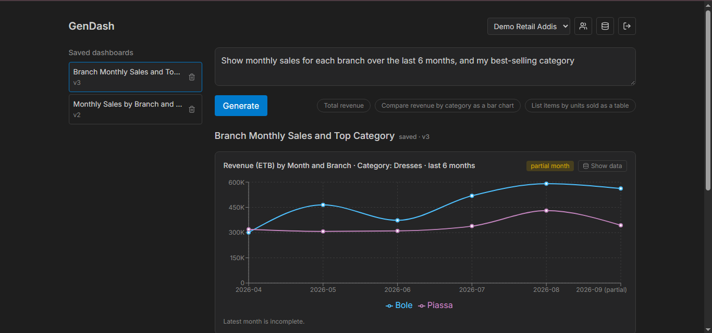
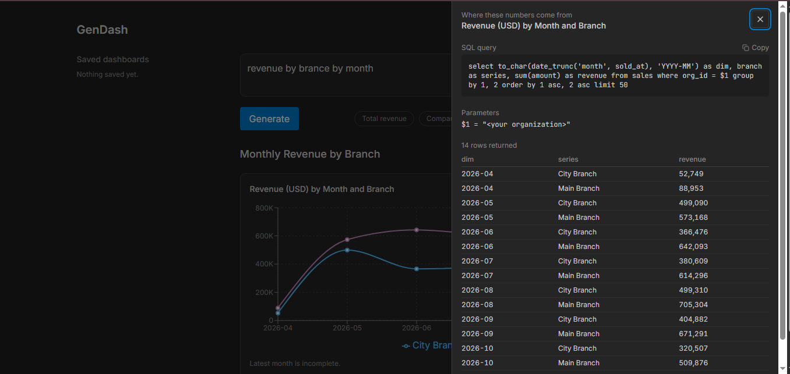
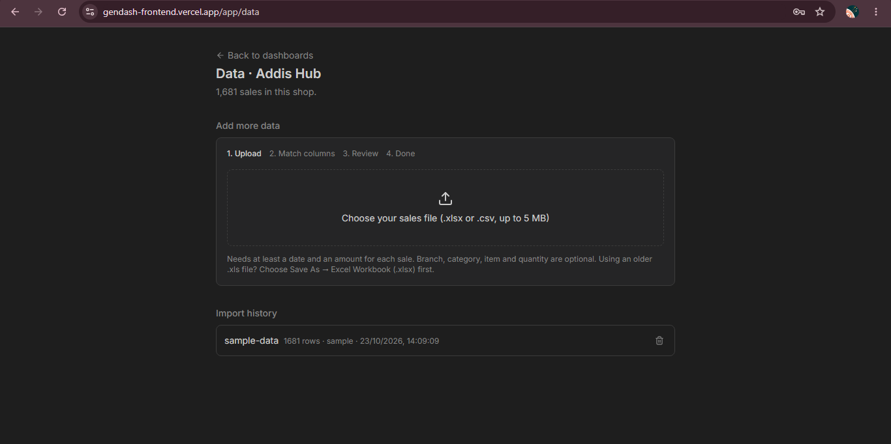

# GenDash

Ask your sales data a question in plain language and get a streamed dashboard. **The AI only plans and arranges; every number comes from SQL.** Click **Show data** on any panel to see the exact query and rows behind it.

**Live app:** <VERCEL_URL> · **API:** https://gendash-backend.onrender.com · **Frontend repo:** https://github.com/kenesa8556/gendash-frontend

> The free Render server sleeps when idle, so the first request can take about 30 s. The app shows a "waking up" message.





## What it does
- Shop owners sign up, create a shop (up to 3), and upload sales data (CSV or .xlsx) with a column-matching wizard and a dry-run review before import.
- Ask "revenue by branch last quarter" or "best-selling dresses by month" and watch panels stream in.
- Save, list, refine (versioned) and delete dashboards.
- Invite teammates by email address (in-app Accept/Decline, no email sent), with owner/member roles.
- Multi-tenant: every query is scoped to the active shop.

## Trust model
1. **The LLM never writes SQL or numbers.** Gemini returns a JSON *plan*, validated with Zod against a semantic layer (allowed metrics, dimensions, filters).
2. **A query engine turns the plan into parameterized SQL** with a mandatory org filter and a per-org "now" anchor.
3. **A spec builder** applies chart rules and flags partial months. The spec contains no numbers.
4. **Provenance:** every panel's SQL and rows are saved (`query_log`) and shown via **Show data**.

```
question → Gemini planner (JSON, 25 s timeout, retry) → Zod validation
        → query engine (parameterized SQL + org filter) → spec builder
        → provenance (query_log) → SSE stream (POST /generate) → React renderer
```

## Stack
- **Backend:** NestJS, TypeScript, Zod v4, Supabase (Postgres, RLS, Auth), `pg` via Session pooler, `@google/genai`, exceljs, helmet. Hosted on Render.
- **Frontend:** Next.js 16, Tailwind v4, Recharts, lucide-react. Hosted on Vercel.

## Evals: how I know the numbers are right
`npm run eval` runs 16 cases against a live backend, with expected values checked against hand-written SQL: totals, isolation between shops, imported CSV/xlsx totals, permission checks, unsupported or vague questions, refine keeping panels, and prompt-injection variants.

- **16/16** on a single pass; **48/48** with `--repeat=3`.
- **Break-it-on-purpose drills:**
  - Multiplying revenue SQL by 1.1 dropped the suite to **9/16**, with the exact 1.1 factor visible.
  - Removing the org filter dropped it to **8/16**, with the cross-shop leak cases failing.
  - The drills exposed a blind spot (one case checked only the winner, not the displayed value), which I fixed.
- The runner exits with an infrastructure error when the backend is unreachable, so an eval can't pass because the backend is down.

Also: 34 unit tests (Jest, 5 suites) and GitHub Actions CI (build + test on push; manual eval workflow using repo secrets).

## Hardening
Zod env validation at startup, helmet, per-user rate limit, daily per-shop generation limit, friendly AI error messages, pg pool closed on shutdown, owner-only data endpoints, last-owner protection.

## Run locally
```bash
git clone https://github.com/kenesa8556/gendash-backend && cd gendash-backend
npm ci
cp .env.example .env   # fill in Supabase + Gemini keys
npm run start:dev
npm test
npm run eval           # needs USER_REQUESTS_PER_MINUTE=100, DAILY_GENERATION_LIMIT=500
```

## Honest limits
- **No email confirmation for the public:** Supabase's default email only reaches my own address; custom SMTP is needed before a real launch. Invitations trust the sign-up email.
- **Rate limiter is in memory** (per instance, resets on restart).
- **Gemini free quota** can run out; the app shows a friendly error.
- **Free Render hosting sleeps;** a warm-up ping and "waking up" message mitigate this.
- **Unsupported metrics:** the planner can't say "I can't compute profit"; it shows an honestly labelled metric instead.
- **Auth adds ~2 s per request** (membership caching postponed).
- **Dependencies:** `npm audit --omit=dev` reports a moderate `uuid` advisory via `exceljs`. The vulnerable path (caller-supplied buffer to uuid v3/v5/v6) isn't reachable from user input, and the only automated fix is a breaking downgrade of exceljs.
- Privacy and terms pages are plain-language drafts, not legal advice. There's no in-app account deletion (done by email).